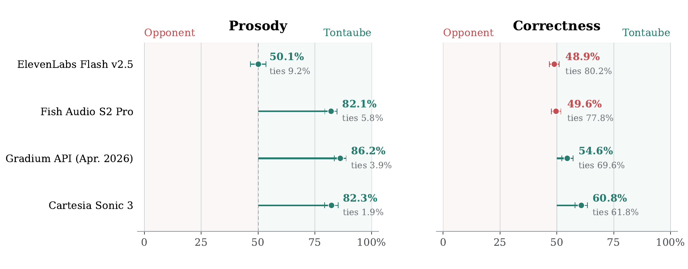

<p align="center">
  
</p>

<h1 align="center">TontaubeV1.1</h1>

TontaubeV1.1 is a multilingual text-to-speech model by Craitech. It is designed
for expressive voice cloning, long-form speech, and low-latency streaming, with
first-class support for English and German and additional support for Spanish,
French, Italian, Dutch, and Portuguese.

This repository contains the inference server. By default it runs the 4-bit
model on small NVIDIA GPUs or on CPUs; a vLLM backend serves the full-precision
model on larger GPUs. The model weights are distributed separately. All enabled
models are downloaded from their original Hugging Face repositories on first
use and reused from local caches on subsequent starts.

[Model weights (4-bit)](https://huggingface.co/TontaubeAI/TontaubeV1.1-int4) ·
[Model weights (full precision)](https://huggingface.co/TontaubeAI/TontaubeV1.1) ·
[Technical report (TontaubeV1)](https://tontaube.ai/papers/tontaube-v1-technical-report.pdf) ·
[Try Tontaube online](https://tontaube.ai/playground)

## Quick start

The shortest supported path requires Linux, an NVIDIA GPU (Ampere or newer) or
an x86-64 CPU, [`uv`](https://docs.astral.sh/uv/getting-started/installation/),
FFmpeg, and the Opus runtime. Clone the release and start the server:

```bash
git clone --branch v1.1.0 --depth 1 https://github.com/craitech/tontaube.git
cd tontaube
uv run --python 3.12 --frozen tontaube serve
```

`uv` creates the environment and installs the locked dependencies. On first
startup, Tontaube downloads all enabled models into local caches; later starts
reuse them. The API is available at `http://127.0.0.1:8080` after model loading
finishes. Check readiness from another terminal with:

```bash
curl --fail http://127.0.0.1:8080/readyz
```

Generate a WAV with the bundled Marcus voice from another terminal:

```bash
curl --silent --show-error --fail http://127.0.0.1:8080/predict \
  -H 'content-type: application/json' \
  -d '{"text":"Welcome to Tontaube.","language":"english","tag":"conversational","format":"wav"}' \
| python3 -c 'import base64,json,sys; sys.stdout.buffer.write(base64.b64decode(json.load(sys.stdin)["audio_b64"]))' \
> welcome.wav
```

Clone a voice from a local audio file by sending it with the request. Use about
5–60 seconds of clean, single-speaker speech; longer references generally give
stronger conditioning, up to the one-minute prompt cap.

```bash
VOICE_FILE=/path/to/reference.wav
python3 -c 'import base64,json,sys; print(json.dumps({"text":"This voice was cloned from a local reference.","language":"english","tag":"conversational","voice_audio_b64":base64.b64encode(open(sys.argv[1],"rb").read()).decode(),"format":"wav"}))' "$VOICE_FILE" \
| curl --silent --show-error --fail http://127.0.0.1:8080/predict \
  -H 'content-type: application/json' \
  --data-binary @- \
| python3 -c 'import base64,json,sys; sys.stdout.buffer.write(base64.b64decode(json.load(sys.stdin)["audio_b64"]))' \
> cloned.wav
```

English text verbalization is optional and disabled by default. To load it,
start the server with `ENABLE_VERBALIZATION=1`; requests that should use it must
also send `"use_verbalization": true`. The verbalizer uses about 1.9 GiB of
additional GPU memory, so leave it disabled when written and spoken forms are
already identical.

### Browser interface

With the API still running, start the optional UI in a second terminal:

```bash
uv run tontaube ui
```

Open `http://127.0.0.1:3000/`. It targets the local API by default, while its
**Server URL** field can point to a remote Tontaube server. The UI and inference
API are separate processes and can be started independently. A machine hosting
only the UI can use `python3 -m app.ui_server` without installing the GPU
environment. A remote API must allow the UI's exact origin through
`TTS_CORS_ORIGINS`.

The UI supports bundled voice selection, local voice-reference uploads, style
sliders, sampling and acoustic controls, WAV/MP3/Opus responses, MP3 streaming,
instant playback, and downloads. It reads its own `voices/` directory and
uploads the selected audio file with each request, so a remote inference server
does not need the sample files. References live together in `voices/samples/`;
optional language and style metadata in `voices/manifest.json` controls language
filtering and groups the voice menu by style.

## Installation details

### Requirements

The supported reference setup is Linux with Python 3.12, on an NVIDIA GPU with
bf16 support (Ampere or newer) or on an x86-64 CPU with AVX2, FMA, and F16C and
a C++ compiler. A Pascal GPU (GTX 10 series) also works, with the CUDA 12.6
PyTorch build and decode kernels for GPUs without tensor cores, both
[selected automatically](#gpus-the-default-pytorch-build-does-not-support). On
Debian or Ubuntu, install the native audio packages with:

```bash
sudo apt-get update
sudo apt-get install -y ffmpeg libopus0
```

Native Windows, macOS, and non-NVIDIA accelerators are not supported; Windows
users can use a CUDA-enabled WSL2 Linux environment. The default backend loads
in about 4 GiB of GPU memory and peaks at about 6.5 GiB. The
[vLLM backend](#vllm-backend) needs at least 24 GiB.

The application pins the Tontaube weights and upstream model revisions for
release `v1.1.0`. For a later release, use its matching source tag; do not mix
model bundles and inference code from different releases. While the Tontaube
repositories are private or gated, provide a read-only `HF_TOKEN`.

The English verbalizer is downloaded only with `ENABLE_VERBALIZATION=1`.
VibeVoice is enabled by default; set `ENABLE_VIBEVOICE=0` to avoid downloading
and loading it. Without VibeVoice, non-streaming requests use raw DualCodec
output and the streaming routes are unavailable.

`tontaube serve` runs model preflight automatically before CUDA initialization.
Run `uv run tontaube preflight` separately only to diagnose model resolution
without starting the server.

### GPUs the default PyTorch build does not support

The default PyTorch wheels (CUDA 12.8) have no kernels for Pascal and older
GPUs (compute capability below 7.0, such as the GTX 10 series). Before any model
is downloaded, `tontaube serve` compares the GPU with the installed build. If
the build does not support it but the CUDA 12.6 build does, a uv checkout
restarts itself in a separate environment, `.venv-cu126`, and prints a line
saying so; the first start downloads several GB (the environment takes about
9 GB on disk). Other installs stop with the commands below. Nothing changes
for supported GPUs, CPU runs, or machines without a GPU.

To select the build yourself, or to install it without the automatic restart:

```bash
UV_PROJECT_ENVIRONMENT=.venv-cu126 uv run --frozen --extra cu126 tontaube serve
```

Without `UV_PROJECT_ENVIRONMENT`, `uv run --frozen --extra cu126` switches the
regular `.venv` to the CUDA 12.6 build.

With pip, in a fresh virtual environment (the extra index carries the CUDA 12.6
wheels):

```bash
python -m pip install --no-deps --require-hashes \
  --extra-index-url https://download.pytorch.org/whl/cu126 \
  -r requirements-pip-cu126.lock
python -m pip install --no-deps --no-build-isolation .
```

`TONTAUBE_TORCH_VARIANT` controls the check: `auto` (default), `default` to
disable it, or `cu126` to always use the CUDA 12.6 build. A GPU older than
compute capability 5.0 supports neither build; use `LITE_DEVICE=cpu`. The vLLM
backend always uses the default build.

These GPUs also have no tensor cores, which the lite backend's decode kernels
(the quantized matrix-vector products and the attention over the KV cache) are
built for: without them, those kernels do many times the necessary work. On
GPUs below compute capability 7.0 the lite backend therefore decodes with
kernels made of plain fp32 multiply-adds instead; Volta and newer GPUs (compute
capability 7.0 and up) keep the tensor-core kernels unchanged. `LITE_FMA_KERNELS` controls the choice: `auto`
(default) as described, `on` to use the multiply-add kernels on every GPU, or
`off` to use the tensor-core kernels on every GPU, for example to compare the
two or to rule out the new kernels when diagnosing a problem.

### Explicit environment setup

The quick-start command handles environment creation automatically. To prepare
the environment separately instead, run:

```bash
uv sync --frozen --python 3.12
uv run tontaube serve
```

Do not replace `uv sync --frozen` with an unconstrained `pip install`. A stale
protobuf upper bound published by a transitive DualCodec dependency conflicts
with vLLM's current protobuf requirement; the repository contains the tested,
narrow override and lock file. Use the dedicated pip procedure below instead.

### pip

The checked-in `requirements-pip.lock` contains the same resolved environment
as `uv.lock`, including hashes. Install every locked dependency without
re-resolving upstream metadata, then install Tontaube itself:

```bash
python3.12 -m venv .venv
source .venv/bin/activate
python -m pip install --no-deps --require-hashes -r requirements-pip.lock
python -m pip install --no-deps --no-build-isolation .
tontaube serve
```

`--no-deps` is intentional here: the complete dependency set is already in the
lock file, and resolving it again would reintroduce AudioTools' obsolete
protobuf constraint. Regenerate `requirements-pip.lock` from `uv.lock` for each
release rather than editing it manually.

### Docker

Docker is available for deployments that want the CUDA and PyTorch stack
encapsulated in an image. Install Docker Engine and the NVIDIA Container
Toolkit, then build and run:

```bash
docker build -t tontaube:1.1.0 .

docker run --rm --gpus all --ipc=host \
  -p 127.0.0.1:8080:8080 \
  -v tontaube-hf-cache:/root/.cache/huggingface \
  -v tontaube-cache:/root/.cache/tontaube \
  tontaube:1.1.0
```

The named volumes preserve downloaded models and the prepared VibeVoice
acoustic component across container runs. Pass `-e HF_TOKEN` while the
Tontaube model repositories are private or gated.

## Highlights

- Synthesis with bundled voices and zero-shot cloning from an audio reference
- `audiobook`, `conversational`, and `agentic` speaking styles
- Five style sliders: speaking rate, pauses, intonation, pitch, and crisp articulation
- Long-form generation with boundary-aware text and audio chunking
- Low-latency MP3 and Opus streaming
- Character-level text tokenization and multilingual language conditioning
- 4-bit weights for small GPUs and CPUs by default, or full precision on vLLM
- Optional English text verbalization, disabled by default

## Examples

These MP3 samples were normalized to a consistent speech listening level. The
German sample was generated with TontaubeV1.

### Audiobook

**English 1**

<audio controls preload="none" src="assets/showcase/english-audiobook-01.mp3"></audio>

[Download MP3](assets/showcase/english-audiobook-01.mp3)

**English 2**

<audio controls preload="none" src="assets/showcase/english-audiobook-02.mp3"></audio>

[Download MP3](assets/showcase/english-audiobook-02.mp3)

**English 3**

<audio controls preload="none" src="assets/showcase/english-audiobook-03.mp3"></audio>

[Download MP3](assets/showcase/english-audiobook-03.mp3)

**German 1**

<audio controls preload="none" src="assets/showcase/german-audiobook-01.mp3"></audio>

[Download MP3](assets/showcase/german-audiobook-01.mp3)

### Agentic

**English 1**

<audio controls preload="none" src="assets/showcase/english-agentic-01.mp3"></audio>

[Download MP3](assets/showcase/english-agentic-01.mp3)

**English 2**

<audio controls preload="none" src="assets/showcase/english-agentic-02.mp3"></audio>

[Download MP3](assets/showcase/english-agentic-02.mp3)

## How it works

Tontaube represents speech with four DualCodec codebooks at 12.5 Hz. CB0
predicts semantic audio tokens autoregressively. CB1, CB2, and CB3 predict the
remaining acoustic codebooks from the completed lower-codebook rows. Acoustic
chunks are independent of preceding acoustic chunks and can therefore be
generated in parallel without accumulating voice drift across a long text.

CB0 is based on Qwen3-1.7B; CB1-CB3 are based on Qwen3-0.6B. Each stage uses a
Tontaube audio-token output head. DualCodec supplies the discrete speech
representation, while a reduced VibeVoice acoustic encoder/decoder is used for
output re-encoding and streaming decode; a small VibeVoice adapter refines the
acoustic latent before decoding. The optional verbalizer is a separately
trained model that converts written English into a more suitable spoken form
before synthesis.

Text is tokenized primarily at the character level. Explicit text and audio
boundaries, together with shared non-linear position IDs across codebooks, keep
the modalities aligned while allowing long texts to continue without audible
cuts. The complete serialization and position-ID scheme is described in the
[technical report](https://tontaube.ai/papers/tontaube-v1-technical-report.pdf).

### Model architecture

| Predictor | Role | Transformer blocks | Width | Stored parameters |
|---|---|---:|---:|---:|
| CB0 | Semantic audio and duration | 28 | 2,048 | 1,854,352,386 |
| CB1 | Acoustic refinement | 16 | 1,024 | 448,960,512 |
| CB2 | Acoustic refinement | 8 | 1,024 | 327,307,264 |
| CB3 | Acoustic refinement | 4 | 1,024 | 268,577,792 |
| **Total** |  | **56** |  | **2,899,197,954** |

### Serving performance

With the default 4-bit model on one NVIDIA GeForce RTX 5090 and the process
warmed, streaming reaches a median of 192 ms to first audio, and synthesis runs
at about 13 times real time for one request and 21–23 times real time across
batched requests (with `MAX_NUM_SEQS_PER_CB=32,32,32,32`). Startup, model
loading, and network latency are excluded.

### Evaluation (TontaubeV1)

The results below were measured with TontaubeV1, the previous release, not with
TontaubeV1.1.

The LLM-as-a-judge pairwise audiobook-reading benchmark contains 400 fixed
English passages of 250--500 characters. For each passage, Gemini 3.1 Pro
Preview judges the same output pair twice, once in each presentation order, on
prosody and word-by-word correctness. A TontaubeV1 preference, tie, or
comparator preference scores 1, 0.5, or 0; the figure reports the mean over all
800 order-balanced judgments. A score of 50% denotes parity. Whiskers show 95%
passage-cluster bootstrap intervals; labels beneath the points give tie rates
across individual judge calls.

<p align="center">
  
</p>

<details>
<summary>Exact preference scores</summary>

| Comparator | Prosody preference | Correctness preference |
|---|---:|---:|
| ElevenLabs Flash v2.5 | 50.1% | 48.9% |
| Fish Audio S2 Pro | 82.1% | 49.6% |
| Gradium API, April 2026 | 86.2% | 54.6% |
| Cartesia Sonic 3 | 82.3% | 60.8% |

</details>

TontaubeV1 uses semantic sampling temperature `0.55` and acoustic temperature
zero in these comparisons. Each waveform is independently normalized to an
average level of -20 dBFS before judging. Fish Audio uses the same frozen
cloning reference as TontaubeV1. ElevenLabs, Gradium, and Cartesia instead use
fixed provider voices while TontaubeV1 uses the cloning reference. Although
voice identity and timbre are excluded from the rubric, prosody is not fully
separable from the reference; this asymmetry may favor TontaubeV1 in those
three comparisons.

This automated evaluation measures English reading prosody and text
correctness. It does not establish voice similarity, overall sound quality,
multilingual quality, long-form continuity, or streaming quality. The
[technical report](https://tontaube.ai/papers/tontaube-v1-technical-report.pdf)
documents the full methodology, judge instructions, and further limitations.

## Model sources and runtime assets

By default, the Tontaube model (`TontaubeAI/TontaubeV1.1-int4`, or
`TontaubeAI/TontaubeV1.1` with the vLLM backend), DualCodec, W2V-BERT, and the
optional verbalizer and VibeVoice source weights are resolved with Hugging Face
Hub and cached under its configured cache directory. The reduced VibeVoice
acoustic model produced from the pinned upstream snapshot is cached separately
under `~/.cache/tontaube`.

Set `CB0_MODEL_PATH`, `CB1_MODEL_PATH`, `CB2_MODEL_PATH`, or `CB3_MODEL_PATH`
to override individual codebooks with local directories. Setting `MODEL_PATH`
uses `<MODEL_PATH>/cb0` through `<MODEL_PATH>/cb3` for all codebooks without
changing where the upstream runtime models resolve. DualCodec, W2V-BERT, and
the prepared VibeVoice acoustic model each have an independent local-path
override. Repository and revision variables provide the corresponding remote
overrides.

Besides `cb0/`–`cb3/`, the model folder holds the CB0-CTC checkpoint
(`cb0/cb0_ctc.pt`), which lets the server regenerate English pieces that
skipped text, the VibeVoice adapter (`vibevoice_adapter.pt`), and in
TontaubeV1.1-int4 the 4-bit layers (`int4/`). The server uses them
automatically.

`tontaube preflight` downloads and prepares enabled generation models, then validates all
required files before GPU initialization. It does not download VibeVoice or the
verbalizer when the corresponding feature is disabled. MossFormer2 is loaded
separately on the first non-streaming request that enables it.
The interactive OpenAPI documentation is available at
`http://127.0.0.1:8080/docs` after startup.

## Generate speech

`POST /predict` returns JSON containing base64-encoded audio. This example
writes the generated WAV to `tontaube.wav`:

```bash
curl --silent http://127.0.0.1:8080/predict \
  -H 'content-type: application/json' \
  -d '{
    "text": "Welcome to Tontaube.",
    "language": "english",
    "tag": "conversational",
    "temperature": 0.7,
    "format": "wav"
  }' \
| python3 -c 'import base64,json,sys; sys.stdout.buffer.write(base64.b64decode(json.load(sys.stdin)["audio_b64"]))' \
> tontaube.wav
```

The defaults are temperature `0.7` and frequency penalty `0.1`. A lower
temperature favors correctness; a higher one can sound more expressive. Pieces
that come out too fast or too slow, or that skip text, are regenerated
automatically (up to five attempts in total). `use_system_tag: false` omits the
language/style control block; it defaults to `true`, using the selected
`language` and `tag`.

The models read text one character at a time (168 supported characters, see
`app/model/text_vocab.py`). Other Latin-script letters lose their accents, and
other scripts, emoji, and control-token markup are removed; a request with no
readable characters left is rejected with status 422.

For voice cloning, provide one of:

- `voice_audio_b64`: base64-encoded reference audio in any FFmpeg-supported format
- `voice_tokens`: precomputed semantic and acoustic prompt-token rows
- `voice_path`: an audio path inside the server's configured `VOICE_PATH`

When no voice source is supplied, the server uses the bundled Marcus reference.
`prompt_max_tokens` can cap CB0 at 1--750 voice-prompt tokens; the later
codebooks apply their own smaller caps. Reference audio should contain clean
speech from one speaker; very quiet or very loud references are brought to a
normal level before encoding.

The bundled catalogue includes 39 standard voices as MP3 references across all
seven languages, plus seven legacy audio voices. Marcus is the default.
Select a voice in the UI, or use `"voice_path": "samples/Marcus.mp3"` with
the default bundled voice directory. Add your own audio files to
`voices/samples/`; see [voice catalogue metadata](voices/README.md).

### Style sliders

TontaubeV1.1 has five style sliders. Pass them as `controls`, one step per
slider from `0` (low end) to the highest step; a slider left out keeps the
model's own choice:

| Slider | Steps | Low end (0) | High end |
|---|---|---|---|
| `rate` | 0–4 | much slower | much faster |
| `pause` | 0–4 | fewer, shorter pauses | more, longer pauses |
| `pitch_range` | 0–5 | flat monotone | very expressive |
| `pitch_level` | 0–4 | low, deep voice | high voice |
| `legato` | 0–2 | crisp staccato | normal articulation |

`legato` is one-sided: step 2 is the model's normal articulation and the
crisp steps 0 and 1 also shorten pauses somewhat.

```bash
curl --silent http://127.0.0.1:8080/predict \
  -H 'content-type: application/json' \
  -d '{"text": "Take it slowly.", "controls": {"rate": 1, "pause": 3}, "format": "wav"}'
```

`GET /controls` lists the sliders of the loaded model. `segment_controls` sets
them per segment of a list `text`.

### Output processing and streaming

Audio is synthesized at 24 kHz. By default, non-streaming `/predict` requests
trim quiet edges to approximately 250 ms of padding, shorten quiet pauses
longer than 2.5 seconds with a crossfade, and return 48 kHz audio using hybrid
MossFormer2_SR_48K enhancement. Set `trim_silence_padding_ms: null` to disable
edge trimming, or `mossformer2_postprocess: false` to disable both enhancement
and pause shortening. Ogg/Opus files always use a 48 kHz playback clock. The
enhancer's approximately 420 MiB of weights are downloaded on first use; expect
a slower first request.

For server-sent MP3 chunks, send the request to `POST /stream`.
`WS /ws/stream` returns framed Opus audio from the 24 kHz synthesis stream.
Streaming does not apply pause shortening or MossFormer2; omit
`mossformer2_postprocess` or set it to `false` for streaming. Streaming always
uses VibeVoice. The `bitrate` and `priority` fields apply to every streaming
route; `vllm_priority` is limited to non-streaming `/predict` calls. An explicit
`format` must match the transport (`mp3` for SSE, `opus` for WebSocket), or it
may be omitted. `max_new_tokens` is the total per-chunk CB0 budget, including
the initial silence token and any early streaming prefix, and accepts 50–400.
`streaming_initial_seconds` controls the first buffered audio chunk. It defaults
to 2.8 seconds and accepts 0.4–6.0 seconds in 0.4-second increments. Increasing
it raises time to first audio but gives playback more headroom; if a custom
`max_new_tokens` value is too small for it, the request is rejected explicitly.

### Continuing from your own audio

To continue or regenerate from a point inside audio you already have, send
`prefix_text` (the text spoken up to the cut) and `prefix_tokens` (every
codebook row of that audio's codes up to the cut frame, for example the
`codebook_tokens` of an earlier `/predict` response). The server returns only
the continuation, faded in over its first 10 ms. Keep your audio up to sample
`cut_frame × 1920` (24 kHz, counted from the start of the codes' audio), fade its
last 10 ms out, and append the
continuation; `app/splice.py` does this:

```python
from app.splice import cut_sample, splice_continuation

kept = my_audio[:cut_sample(cut_frame, sample_rate=24000)]
joined = splice_continuation(kept, continuation_audio, sample_rate=24000)
```

## Configuration

The main runtime settings are environment variables:

| Variable | Purpose |
|---|---|
| `TTS_BACKEND` | `lite` (default: the 4-bit model, GPU or CPU) or `vllm` (full precision) |
| `TONTAUBE_TORCH_VARIANT` | PyTorch build check at start: `auto` (default), `default` (skip the check), or `cu126` (CUDA 12.6 build for older GPUs) |
| `TTS_MODEL_REPO_ID` | HF repository containing `cb0/` through `cb3/`; defaults to `TontaubeAI/TontaubeV1.1-int4` (`TontaubeAI/TontaubeV1.1` with vLLM) |
| `TTS_MODEL_REVISION` | HF model revision; defaults to `v1.1.0` |
| `CB0_MODEL_PATH` ... `CB3_MODEL_PATH` | Optional per-codebook local-directory overrides |
| `MODEL_PATH` | Optional local root containing `cb0/` through `cb3/` |
| `DUALCODEC_MODEL_PATH` | Optional local DualCodec snapshot override |
| `DUALCODEC_MODEL_REPO_ID`, `DUALCODEC_MODEL_REVISION` | Optional DualCodec Hub source overrides |
| `W2VBERT_MODEL_PATH` | Optional local W2V-BERT model override |
| `W2VBERT_MODEL_REPO_ID`, `W2VBERT_MODEL_REVISION` | Optional W2V-BERT Hub source overrides |
| `VIBEVOICE_MODEL_PATH` | Optional local prepared VibeVoice acoustic-model override |
| `VIBEVOICE_MODEL_REPO_ID`, `VIBEVOICE_MODEL_REVISION` | Optional VibeVoice Hub source overrides |
| `MOSSFORMER2_SR_MODEL_PATH` | Optional local directory containing the two MossFormer2_SR_48K checkpoints |
| `MOSSFORMER2_SR_REPO_ID`, `MOSSFORMER2_SR_REVISION` | Optional MossFormer2_SR_48K Hub source overrides |
| `TONTAUBE_CACHE_DIR` | Cache for derived Tontaube runtime artifacts; defaults to `~/.cache/tontaube` |
| `VOICE_PATH` | Inference-server folder used for server-side `voice_path` requests and relative `DEFAULT_VOICE` overrides |
| `DEFAULT_VOICE` | Audio reference used when none is supplied; defaults to bundled `samples/Marcus.mp3`, or accepts a path relative to `VOICE_PATH` or an absolute path |
| `VOICE_REF_LEVEL_WINDOW` | Speech-level range for voice references in dB; defaults to `-26,-14`, `off` disables it |
| `REQUIRE_API_KEY` | Require an `x-api-key` header; defaults to `0` |
| `TTS_API_KEY` | Shared secret used when authentication is enabled |
| `TTS_CORS_ORIGINS` | Comma-separated browser origins allowed to call the API; defaults to the local UI on port 3000 |
| `ENABLE_STREAMING` | Enable SSE and WebSocket routes; defaults to `1` |
| `ENABLE_VIBEVOICE` | Load VibeVoice for output re-encoding and streaming; defaults to `1` |
| `TTS_UI_HOST` | Bind address for the standalone UI-only server; defaults to `127.0.0.1` |
| `TTS_UI_PORT` | Port for the standalone UI-only server; defaults to `3000` |
| `TTS_UI_VOICE_PATH` | Local sample-voice root served by the UI; defaults to the repository's `voices/` folder |
| `TTS_HOST` | HTTP bind address; defaults to `127.0.0.1` (`0.0.0.0` in Docker) |
| `TTS_PORT` | HTTP port; defaults to `8080` (`PORT` remains a fallback) |
| `TTS_LOG_LEVEL` | Runtime log level; defaults to `INFO`, use `DEBUG` for token and decoding diagnostics |
| `ENABLE_VERBALIZATION` | Load the optional English verbalizer; defaults to `0` |
| `VERBALIZATION_MODEL_REPO_ID` | HF verbalizer repository; defaults to `TontaubeAI/TontaubeV1-Verbalizer` |
| `VERBALIZATION_MODEL_REVISION` | HF verbalizer revision; defaults to `v1.0.0` |
| `VERBALIZATION_MODEL_PATH` | Optional local verbalizer-directory override |
| `TTS_CAPACITY_PROFILE` | `minimal`, `low-vram` (default with lite), `balanced` (default with vLLM), or `high-throughput` |
| `MAX_NUM_SEQS_PER_CB` | Four comma-separated active-sequence limits |
| `MAX_INFLIGHT_REQUESTS` | End-to-end request limit; defaults to twice the CB0 active-sequence limit |

To enable API-key authentication, provide both settings:

```bash
docker run --rm --gpus all --ipc=host \
  -p 127.0.0.1:8080:8080 \
  -v /absolute/path/to/tontaube-models:/srv/models:ro \
  -e MODEL_PATH=/srv/models \
  -e REQUIRE_API_KEY=1 \
  -e TTS_API_KEY="replace-with-a-secret" \
  tontaube:1.1.0
```

To enable the verbalizer, set `ENABLE_VERBALIZATION=1`. It must resolve and load
successfully at startup, and individual requests must also set
`"use_verbalization": true`. Such a request returns an explicit error when the
verbalizer is unavailable or the requested language is not English. When
verbalization is disabled, the model is not loaded.

## Lite backend

The default backend runs all four codebook models in the API process with
weight-only 4-bit layers, CUDA graphs, and a paged KV cache. It loads in about
4 GiB of GPU memory and peaks at about 6.5 GiB (long texts, encoding a voice
reference for cloning, MossFormer2 enhancement); the optional verbalizer adds
1.9 GiB. It serves the same API as the vLLM backend.

| Variable | Purpose |
|---|---|
| `LITE_QUANT` | `auto` (default: the model folder's `int4/` bundle, else `bf16`), a bundle directory, or a plan string |
| `LITE_DEVICE` | `cuda` or `cpu`; defaults to the GPU when one is available |
| `LITE_CPU_THREADS` | Threads on the CPU; default one per physical core |
| `LITE_KV_TOKENS_PER_CB` | Paged KV pool per codebook in tokens; default `max_model_len * max_num_seqs` |
| `LITE_FMA_KERNELS` | Decode kernels for GPUs without tensor cores: `auto` (default: on GPUs below compute capability 7.0, such as Pascal), `on` (every GPU), or `off` (never; the tensor-core kernels everywhere) |

To build your own bundle (for example int8), quantize the full-precision model
once on a GPU that can hold it (about 12 GiB), then serve the bundle with it:

```bash
uv run tontaube quantize --preset int8 --out ~/tontaube-int8
TTS_MODEL_REPO_ID=TontaubeAI/TontaubeV1.1 LITE_QUANT=~/tontaube-int8 uv run tontaube serve
```

A bundle records which weights it was quantized from, and the server refuses
to load it onto other weights. Plan strings such as `int8g128` (see
`app/lite/plans.py`) are quantized at startup and also need the full-precision
model.

### CPU-only inference

On a Linux x86-64 machine without a GPU (or with `LITE_DEVICE=cpu`), the same
command runs the 4-bit model on the CPU. It needs AVX2, FMA, and F16C and a C++
compiler; the kernels in `app/native/` are compiled on first start and cached in
`TONTAUBE_CACHE_DIR`. Speed is bound by memory bandwidth: a 12-core desktop CPU
with dual-channel DDR4 synthesizes at about real time, so a long stream can
pause between chunks. MossFormer2 is off by default on the CPU. The verbalizer
needs a GPU; leave `ENABLE_VERBALIZATION` unset on a machine without one.

## vLLM backend

`TTS_BACKEND=vllm` serves the full-precision `TontaubeAI/TontaubeV1.1` with one
vLLM engine per codebook, for higher throughput on larger GPUs. It needs an
NVIDIA GPU with at least 24 GiB of VRAM for the `low-vram` or default `balanced`
profile, and at least 32 GiB for `high-throughput`:

```bash
TTS_BACKEND=vllm TTS_CAPACITY_PROFILE=low-vram uv run tontaube serve
```

All per-codebook variables are ordered `cb0,cb1,cb2,cb3`:

| Profile | Active sequences (CB0--CB3) | End-to-end requests | GPU memory in GiB (CB0--CB3) | Batched tokens (CB0--CB3) |
|---|---|---|---|---|
| `low-vram` | 1, 4, 4, 4 | 2 | 4.500, 1.860, 1.420, 1.220 | 2,500, 8,000, 9,600, 12,000 |
| `balanced` | 3, 8, 8, 8 | 6 | 4.900, 2.470, 1.920, 1.590 | 7,500, 16,000, 19,200, 24,000 |
| `high-throughput` | 8, 20, 20, 20 | 16 | 6.954, 5.204, 3.728, 3.250 | 20,000, 40,000, 48,000, 60,000 |

`GPU_MEMORY_GIB_PER_CB`, `MAX_MODEL_LEN_PER_CB`, `MAX_NUM_SEQS_PER_CB`,
`MAX_NUM_BATCHED_TOKENS_PER_CB`, `MAX_INFLIGHT_REQUESTS`, and
`VERBALIZATION_GPU_MEMORY_GIB` override the profile. Keep each batched-token
budget equal to the context limit times the active-sequence limit, so every
active sequence fits in one prefill step, and leave memory unassigned for
DualCodec, VibeVoice, CUDA, and request-time tensors. The first clean-cache
start may use more memory while vLLM compiles kernels; lower the budgets if it
runs out of memory, and load-test custom values on the target GPU.

## Development

Install the repository with [uv](https://docs.astral.sh/uv/). The project
metadata includes a narrow compatibility override for an obsolete protobuf
constraint in AudioTools 0.7.2, which is pulled by DualCodec 0.4.2:

```bash
uv sync --frozen --python 3.12 --extra dev
```

This creates `.venv` and registers the custom Tontaube architecture as a vLLM
plugin in the API process and its engine workers. `uv sync` without
`--extra dev` installs only the runtime dependencies. A plain `pip install .`
cannot resolve the mutually exclusive protobuf metadata published by vLLM
0.16.0 and AudioTools 0.7.2; the Docker build uses the same explicit override
through uv's pip-compatible installer.

Run the unit tests without writing cache files into the repository:

```bash
PYTHONDONTWRITEBYTECODE=1 uv run pytest -q -p no:cacheprovider tests
```

## Limitations and responsible use

Autoregressive generation can omit, repeat, or alter text and can terminate
too early or too late. Reference conditioning may reproduce incidental
recording properties or imperfectly preserve identity. Quality varies by
language, speaker, style, and text domain. The optional verbalizer can
normalize incorrectly or alter wording. Audiobook generation may be more
reliable than conversational or agentic generation.

English and German are the primary languages. German phoneme realization can
be imperfect, and Spanish, French, Italian, Dutch, and Portuguese have not been
evaluated by native speakers; no comparative quality claims are made for those
languages.

Voice cloning can enable impersonation, fraud, non-consensual synthesis, and
misleading media. Obtain permission for reference voices and apply appropriate
authentication, rate limiting, disclosure, logging, and abuse-response
measures in deployed systems. Generated speech must not be treated as verified
identity or factual evidence.

The default unauthenticated server binds only to loopback and is intended for
local use. Before exposing it to a network, enable API-key authentication and
put it behind TLS and appropriate request/rate limits.

## Roadmap

We plan to publish fine-tuning code in a future release.

## Acknowledgements

Tontaube builds on [Qwen3](https://github.com/QwenLM/Qwen3),
[DualCodec](https://github.com/jiaqili3/DualCodec), and
[VibeVoice](https://github.com/microsoft/VibeVoice). Their respective licenses
and attribution requirements continue to apply.

## License

Except for the third-party components identified in
[`THIRD_PARTY_NOTICES`](THIRD_PARTY_NOTICES), the inference source code in this
repository is licensed under the [Apache License 2.0](LICENSE). The vendored
VibeVoice subset remains under its [MIT license](VibeVoice/LICENSE).
The synthetic sample voices in `voices/` are released separately under the
[MIT License](voices/LICENSE). The generated showcase audio in
`assets/showcase/` is provided as demonstration material and is not covered by
the Apache License 2.0.

The Apache License does not apply to model weights, tokenizer or codec weights
and data, configuration files distributed with those model artifacts, or other
separately distributed model artifacts. Tontaube-owned model materials are
licensed separately under the
[Tontaube Community Model License 1.0](https://huggingface.co/TontaubeAI/TontaubeV1.1/blob/v1.1.0/LICENSE);
third-party model artifacts remain subject to their respective licenses.
